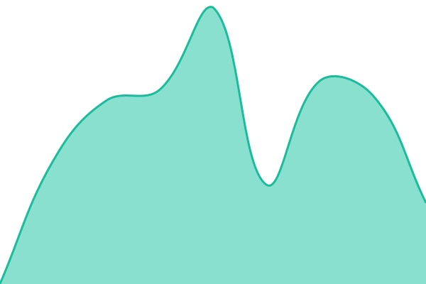

# [📈 Live Status](https://demo.upptime.js.org): <!--live status--> **🟩 All systems operational**

This repository contains the open-source uptime monitor and status page for [teplostanski](https://teplostanski.me), powered by [Upptime](https://github.com/upptime/upptime).

With [Upptime](https://upptime.js.org), you can get your own unlimited and free uptime monitor and status page, powered entirely by a GitHub repository. We use [Issues](https://github.com/teplostanski/status/issues) as incident reports, [Actions](https://github.com/teplostanski/status/actions) as uptime monitors, and [Pages](https://demo.upptime.js.org) for the status page.

<!--start: status pages-->
<!-- This summary is generated by Upptime (https://github.com/upptime/upptime) -->
<!-- Do not edit this manually, your changes will be overwritten -->
<!-- prettier-ignore -->
| URL | Status | History | Response Time | Uptime |
| --- | ------ | ------- | ------------- | ------ |
|  [hacks.run](https://hacks.run) | 🟩 Up | [hacks-run.yml](https://github.com/teplostanski/status-hacks-run/commits/HEAD/history/hacks-run.yml) | 

 452ms
     
 | 

<a href="https://status.hacks.run/history/hacks-run">99.49%</a>
    

|  [200ok API](https://200ok.hacks.run/) | 🟩 Up | [200ok-api.yml](https://github.com/teplostanski/status-hacks-run/commits/HEAD/history/200ok-api.yml) | 

 954ms
     
 | 

<a href="https://status.hacks.run/history/200ok-api">100.00%</a>
    

|  [Rand API](https://rand.hacks.run/) | 🟩 Up | [rand-api.yml](https://github.com/teplostanski/status-hacks-run/commits/HEAD/history/rand-api.yml) | 

 694ms
     
 | 

<a href="https://status.hacks.run/history/rand-api">100.00%</a>
    

|  [Undevice Docs](https://undevice.hacks.run/) | 🟩 Up | [undevice-docs.yml](https://github.com/teplostanski/status-hacks-run/commits/HEAD/history/undevice-docs.yml) | 

 309ms
     
 | 

<a href="https://status.hacks.run/history/undevice-docs">100.00%</a>
    

|  [Kaomoji API](https://kaomoji.hacks.run) | 🟩 Up | [kaomoji-api.yml](https://github.com/teplostanski/status-hacks-run/commits/HEAD/history/kaomoji-api.yml) | 

 893ms
     
 | 

<a href="https://status.hacks.run/history/kaomoji-api">93.46%</a>
    

<!--end: status pages-->

## 📄 License

- Powered by: [Upptime](https://github.com/upptime/upptime)
- Code: [MIT](./LICENSE) © [Anand Chowdhary](https://anandchowdhary.com)
- Data in the `./history` directory: [Open Database License](https://opendatacommons.org/licenses/odbl/1-0/)
